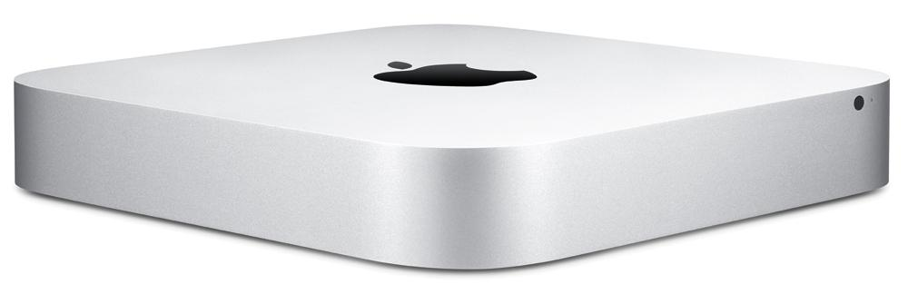

# [A1](https://support.apple.com/en-us/111926)

- 2.6GHz quad-core Intel Core i7 (Turbo Boost up to 3.6GHz)
- 16GB (two 8GB) of 1600MHz DDR3 memory
- 1TB (5400-rpm) hard drive
- 2TB SSD Crucial

## Catalina
-  macOS 10.15 Catalina, from 2019, is the last supported. 
- [In which month or year Catalina will stop to be supported ?](https://discussions.apple.com/thread/255619465)
 
## Omarchy
- time to try installing omarchy on it
- [The Omarchy Manual](https://learn.omacom.io/2/the-omarchy-manual)
```
curl -O https://iso.omarchy.org/omarchy-3.1.7.iso
diskutil list # what disk is usb?
sudo dd if=omarchy-3.1.7.iso of=/dev/usb_disk bs=1M conv=sync
```
## [a1.c](https://github.com/5eed1ab/A1/blob/main/a1.c)
### a1.c modified to use `%s`, `%c`, and `\n` in printf
- a `char` is a byte storing a single ASCII value like '?' or 63
  - `char character`
- C does not have a String type to easily create string variables. 
  - Instead, you must use the char type and create an array of characters.
  - `char characters[]`
#### printf format specifiers and escape sequences
| format | description |
|-------:|:------------|
%s       | The char * argument is expected to be a pointer to an array of character type (pointer to a string).  Characters from the array are written up to (but not including) a terminating NUL character; if a precision is specified, no more than the number specified are written.  If a precision is given, no null character need be present; if the precision is not specified, or is greater than the size of the array, the array must contain a terminating NUL character.|
%c       | The int argument is converted to an unsigned char, and the resulting character is written.
\n       | The ASCII value 10 represents the Line Feed (LF) control character, often shown as `\n`, used to start a new line in text

`make`
```
cc a1.c -o a1
```

`./a1`
```
Hello, is there anybody in there?
```
### Read the man pages
man command  | Description
|------------|-------------|
man less     | less - opposite of more
man man      | the man utility finds and displays online manual documentation pages
man make     | to determine automatically which pieces of a large program need to be recompiled
man ascii    | ascii – octal, hexadecimal and decimal ASCII character sets
man printf   | printf – formatted output
man 3 printf | the printf() family of functions produces output according to a format as described below.
man 3 stdio  | the standard I/O library provides a simple and efficient buffered stream I/O interface.